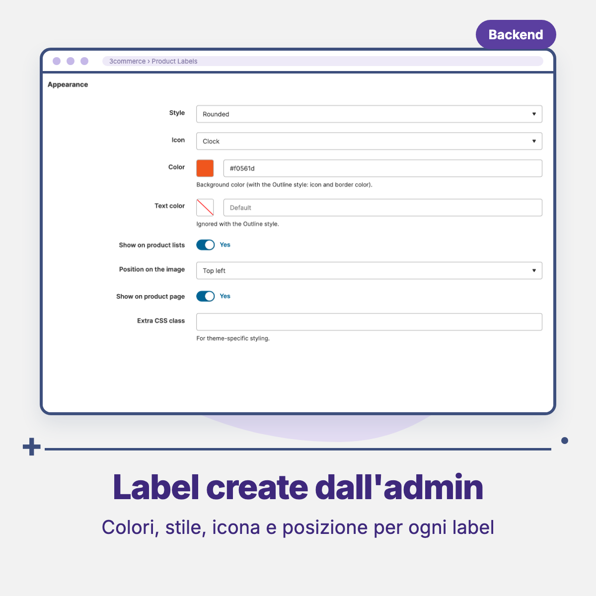
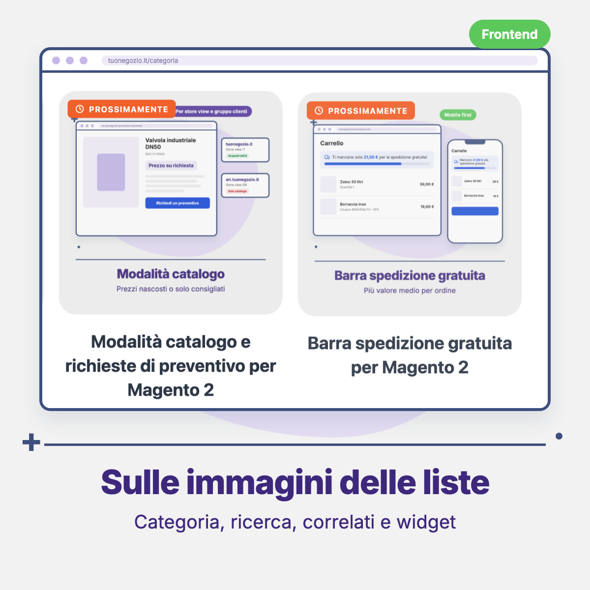

# Threecommerce_Label: product labels for Magento 2 / Mage-OS

Configurable **product labels** for Magento 2 and Mage-OS: "New", "Coming soon", "On sale -20%", "Out of stock", "Free shipping"... shown on product images in listings and on the product page. Labels are created in the admin and applied automatically by condition.

**Compatibility:** Magento Open Source / Adobe Commerce 2.4.4 – 2.4.9 · Mage-OS 1.x / 3.x · PHP 8.1 – 8.4 · Themes: Luma, Breeze, Hyvä
**License:** commercial · coming soon

## Features

- Grid and form under **3commerce → Product Labels**, with a label preview in the grid and mass actions.
- Conditions that apply a label automatically:
  - selected products (list of SKUs);
  - new product (native "Set product as new from/to" dates);
  - created in the last N days;
  - on sale (final price lower than regular price); `{discount}` in the text becomes the discount percentage, e.g. `-{discount}%`;
  - out of stock / not purchasable;
  - value of an attribute (option ID, option text or value; several values separated by commas);
  - all products.
- Priority, and "Hide lower priority labels" (for example no "New" on "Coming soon" products).
- Validity period (from / to) and store view.
- Appearance: background and text color, style (rounded, pill, square, light with colored icon), 12 SVG icons, position on the image (4 corners), extra CSS class.
- Labels can be enabled separately for product lists and for the product page.
- No JavaScript on the storefront: plain HTML and CSS with CSS variables.
- Page cache is cleaned when labels are saved. Italian translation included.

## Requirements

- Magento Open Source / Adobe Commerce 2.4.4+ or Mage-OS
- PHP 8.1 – 8.4
- Package: `threecommerce/m2-base`

## Availability

This module is not yet available for purchase. See the [product page](https://www.threecommerce.it/label-prodotto-personalizzabili-magento-2?utm_source=github&utm_medium=readme&utm_campaign=magento2-label) for its status, or [contact us](https://www.threecommerce.it/contatti?utm_source=github&utm_medium=readme&utm_campaign=magento2-label) to be notified when it is released or to ask for information.

## Configuration

Admin → **Stores → Configuration → Threecommerce Plugins → Product Labels**: enable, maximum number of labels per product (default 3, 0 = no limit), automatic insertion on listing images and the image IDs that receive labels, automatic insertion on the product page. Labels themselves are created in **3commerce → Product Labels**. Themes that print their own markup can output labels with the bundled view model.

## Documentation and support

- Product page: [threecommerce.it/label-prodotto-personalizzabili-magento-2](https://www.threecommerce.it/label-prodotto-personalizzabili-magento-2?utm_source=github&utm_medium=readme&utm_campaign=magento2-label)
- [Changelog](CHANGELOG.md) (in Italian)
- Support and custom development: [threecommerce.it/contatti](https://www.threecommerce.it/contatti?utm_source=github&utm_medium=readme&utm_campaign=magento2-label)

---

*This repository is the public showcase of the module. The source code is kept in a private repository.*
